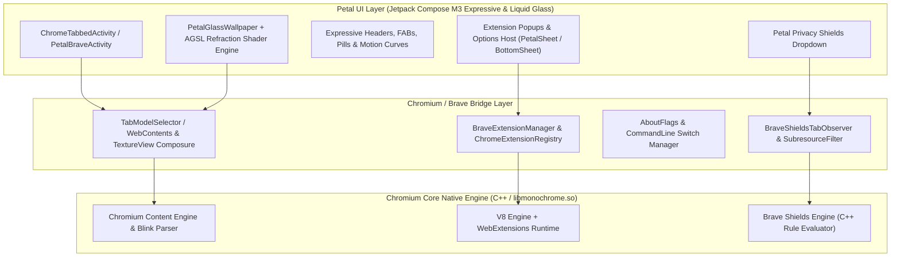

# Petal Browser (Chromium / Brave Engine Fork)

Petal Browser is a privacy-first, next-generation Android web browser featuring:
- **Full Chromium Engine Core (Forked from Brave Core)**: Zero dependency on Android System WebView. Full hardware-accelerated Blink rendering engine, V8 JavaScript runtime, and isolated multi-process security architecture.
- **Chrome Web Store Extension Support**: Native Manifest V2 / V3 extension ecosystem (`chrome.runtime`, `chrome.tabs`, `chrome.windows`, background workers, content scripts).
- **Native `chrome://flags` & Feature Engine**: Direct access to Chromium experiment toggles and dynamic command-line engine switches.
- **Brave Shields Privacy Engine**: C++ subresource adblock filtering, tracker prevention, cookie isolation, and script protections.
- **Material 3 Expressive & Liquid Glass**: Seamless integration of Google's Material 3 Expressive motion and Petal's signature Liquid Glass frosted-refraction design language (backed by Android AGSL runtime shaders & RenderEffect).

---

## Architecture Overview



---

## Directory Structure

```
petal-browser/
├── .github/
│   └── workflows/
│       ├── build-brave-core.yml        # CI Cloud Runner Chromium compile & packaging
│       └── release.yml                 # Standalone APK build (arm64-v8a, armeabi-v7a)
├── patches/
│   ├── brave/                          # Brave-core modifications & hook patches
│   └── petal/                          # Petal UI, M3 Expressive & Liquid Glass patches
├── src/petal/
│   ├── java/com/petal/browser/
│   │   ├── engine/                     # Chromium / Brave JNI bridge abstractions
│   │   └── ui/
│   │       ├── containment/            # PetalSheet, PetalPopupMenu, LiquidGlassChrome
│   │       ├── glass/                  # TextureView backdrop capture & AGSL shaders
│   │       ├── theme/                  # M3 Expressive tokens & Liquid Glass color styles
│   │       └── components/             # Omnibox, Expressive FABs, Sliders, Shields UI
│   └── res/                            # Petal drawables, shapes, colors, layout resources
├── scripts/
│   ├── bootstrap.sh                    # Setup depot_tools and Brave workspace
│   ├── apply_patches.sh                # Apply Petal patchsets over brave-core
│   └── build_apk.sh                    # Local / containerized compilation trigger
└── docs/
    ├── M3_EXPRESSIVE_AND_GLASS.md      # Rules for combining M3 Expressive & Liquid Glass
    └── CHROMIUM_ARCHITECTURE.md        # Chromium WebContents & JNI integration details
```
